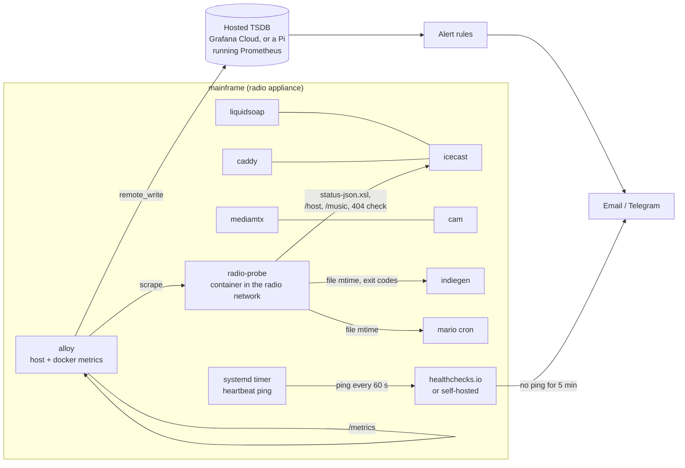

# 04 — Monitoring architecture

**Deliverable 3.** What to measure, with what, where it goes, and what happens
when the box dies and therefore cannot tell you it died.

## The constraint that shapes everything

Every local monitoring stack has the same flaw: **it runs on the thing it
watches**. When the box overheats and shuts down, the last thing you lose is the
alarm. That is exactly the scenario that already happened here.

So the architecture has two halves:

1. **Collection** on the box, cheap and dumb.
2. **Evaluation and alerting** somewhere that is not the box.

## Tooling evaluation

Footprints are ESTIMATED from typical container sizes on this workload class;
the only way to be sure is to run them, which the audit will do once the box is
up.

| Option | Resident cost on the box | Alerting when the box is down | Verdict |
|---|---|---|---|
| **Netdata (agent only)** | 150–350 MiB, 1–5 % CPU, plus disk for its own DB | No — alerts die with the box unless Netdata Cloud is used | Excellent for a human looking at a dashboard; wrong primary. |
| **Prometheus + node_exporter + Alertmanager, all on the box** | 400–900 MiB with retention on disk | No. It also adds a disk-growth problem to a box that ran out of resources. | Rejected: the monitoring becomes a victim. |
| **Monit / systemd-only checks** | ~10 MiB | No — but it can restart services locally, which is genuinely useful | Good *complement*, useless as the only layer: it cannot tell you the box is gone. |
| **bash + systemd + curl, push to an external endpoint** | ~0 | Yes, if the push is the signal | Cheap, honest, and the only option here that survives a dead box. |
| **Grafana Alloy (OTel-collector-compatible) + remote_write to a hosted TSDB** | 80–150 MiB | Yes — evaluation is remote | **Recommended.** One binary, embedded `node_exporter`, Docker metrics, log forwarding if wanted later. |
| **Self-hosted Grafana/Prometheus on a second small machine** | 0 on the box | Yes | **Recommended alternative** if the data must stay on the LAN. Costs a second always-on device (Pi, NAS). |

The two recommended options differ only in *where the TSDB lives*. Both put
evaluation off the box, which is the property that matters.

## Recommended topology



Two independent failure signals, deliberately:

- **Metrics missing** → the scrape stopped. Detected remotely.
- **Heartbeat missing** → nothing on the box is alive. Detected by a service the
  box does not own.

If both are on the same host, you have one signal and a false sense of coverage.

## What runs on the box

### 1. `radio-probe` — a tiny container inside the `radio` network

Caddy gates every endpoint with a token, so an external prober cannot see the
stack's internals. A prober **inside** the Compose network can:

```yaml
  probe:
    image: alpine:3.20
    container_name: radio-probe
    restart: unless-stopped
    command: ["sh", "-c", "while true; do sleep 3600; done"]
    networks: [radio]
    security_opt: ["no-new-privileges:true"]
    cap_drop: [ALL]
    mem_limit: 32m
```

It is not a daemon; it is a shell that exists so `docker exec` has a place to
run, and so the health script has a network position. The health script itself
lives in `infra/monitoring/radio-health.sh` and exits non-zero with a
machine-readable line per check.

### 2. `alloy` — collection

Scrapes the probe's script output (via a tiny `textfile` collector or a
`prometheus.exporter` wrapper), the host (`prometheus.exporter.unix`), and the
Docker daemon. `remote_write` to the TSDB. No local retention: this box should
not grow a database.

Cost: ~100 MiB. That is 3 % of a 4 GB box, and it buys the whole rest of this
document.

### 3. Heartbeat timer

```ini
# /etc/systemd/system/radio-heartbeat.service
[Unit]
Description=Radio appliance heartbeat
[Service]
Type=oneshot
ExecStart=/usr/bin/curl -fsS -m 10 --retry 3 https://hc-ping.com/<uuid>
```

```ini
# /etc/systemd/system/radio-heartbeat.timer
[Unit]
Description=Ping the dead-man switch every minute
[Timer]
OnBootSec=2min
OnUnitActiveSec=60s
[Install]
WantedBy=timers.target
```

The check is configured to alert when it has not been pinged for **5 minutes**.
Five minutes is chosen so a `systemctl restart` or a kernel upgrade does not
page anyone, while a thermal shutdown does — within the same coffee.

## Metrics catalog

Everything below is either scraped or probed. Nothing is "nice to have": each
row names the failure it catches.

### Hardware and thermal

| Metric | Source | Catches |
|---|---|---|
| `node_hwmon_temp_celsius` (package, core, NVMe composite) | `hwmon` | The trend that precedes throttling |
| `node_hwmon_fan_rpm` | `hwmon` | A fan that stopped, or a bearing failing |
| Throttle events this boot | `journalctl -k` grep, exported as a counter by the probe | The retroactive proof that performance was lost |
| `node_cpu_seconds_total` per core | `procfs` | A single core pinned by one encoder |
| `node_load1` **divided by core count** | `procfs` | Load of 4 on 4 cores is fine; on 2 cores it is an incident |
| `node_pressure_cpu_waiting_seconds_total` | `procfs` PSI | Threads waiting for CPU, which is what an encoder with a deadline feels |

### Memory

| Metric | Source | Catches |
|---|---|---|
| `node_memory_MemAvailable_bytes` | `procfs` | The only honest free-memory figure |
| `node_memory_SwapFree_bytes` + zram `mem_used_total` | `procfs`/`sysfs` | Swap growth = leak; zram growth = pressure |
| `node_pressure_memory_stalled_seconds_total` (PSI `full`) | `procfs` | The box is up but nothing is progressing |
| `node_vmstat_oom_kill` | `procfs` | An OOM kill happened, immediately |
| Per-container `container_memory_working_set_bytes` | cAdvisor/Alloy | Which container is the offender |
| Per-container `container_memory_failcnt` / limit | cAdvisor | A container approaching its cap, before it dies |

### Disk

| Metric | Source | Catches |
|---|---|---|
| `node_filesystem_avail_bytes` per mount | `procfs` | Slow death by log growth |
| `node_filesystem_files_free` (inodes) | `procfs` | btrfs snapshots / many small files |
| `node_disk_io_time_seconds_total`, `node_disk_write_time_seconds_total` | `procfs` | An image build saturating the SSD while audio is written |
| `node_pressure_io_stalled_seconds_total` | PSI | I/O stalls that look like "the box is slow" |
| `docker_system_df` (images/build cache size) | Docker API via Alloy | The specific multi-GB leak on this host |

### Network

| Metric | Source | Catches |
|---|---|---|
| `node_network_receive_bytes_total` / `transmit` per iface | `procfs` | Stream egress collapse, or an unexpected upload |
| `node_netstat_Tcp_RetransSegs` | `procfs` | LAN/Wi-Fi trouble masquerading as a stream problem |

### Docker and services

| Metric | Source | Catches |
|---|---|---|
| `container_cpu_usage_seconds_total` per container | cAdvisor | `cam` eating the box |
| `container_last_seen` / restart count | cAdvisor/Docker API | A restart loop |
| `container_start_time_seconds` | cAdvisor | Container restarted recently, even if healthy now |
| systemd unit state (`node_systemd_unit_state`) | `procfs`/dbus exporter | `caddy` inactive while everything else looks fine |

### Radio-specific — the ones that actually matter

| Check | How, exactly | Fails when |
|---|---|---|
| **Icecast has a source** | `curl -s http://icecast:8000/status-json.xsl` and assert `icestats.source` is present and `listenurl` matches `/stream` | Liquidsoap disconnected: the stream URL is alive but silent |
| **Audio is actually flowing** | Same endpoint, `total_bytes_read` (or `total_bytes_sent`), sampled twice; rate must be > 0 and roughly the bitrate | Encoder stalled, silence loop |
| **The gate is enforcing** | `GET http://caddy/` **without a token** must return 404 | A Caddyfile change accidentally opened the door |
| **Caddy serves TLS** | `curl -sS -m 5 https://stream.daza.ar/ -o /dev/null -w '%{http_code}'` from outside must be 404 (not a timeout) | The box is unreachable, or Caddy is down |
| **MediaMTX is accepting publishers** | TCP connect to `mediamtx:8554`, plus `webrtc` UDP 8189 reachable from the LAN client. `api: no` in `mediamtx.yml` means there is no metrics endpoint — either enable `api: yes` bound to `127.0.0.1` or accept a connect-check only | Camera publishing stopped |
| **Camera produces segments** | Newest `data/cam/*.m3u8` mtime < 15 s | ffmpeg died, or the USB camera dropped off the bus |
| **Mario cycle succeeded** | `data/host/rss-cache` and newest segment mtime < 2 h, and the cron wrapper's last exit code is 0 | TTS failed silently at 3 a.m. |
| **Indiegen cycle succeeded** | `data/indiegen/state.json` mtime advanced within `INDIEGEN_INTERVAL_SECONDS` + 30 min; `runs/` newest run has no `FAIL` marker | A rotation stalled: the library stops changing, nobody notices for days |
| **Library is not empty** | Count of `*.flac` in `music-audio` > 0 and metadata `catalog.json` parses | The rotation deleted before publishing (the failure mode the atomic publish exists to prevent) |

The last row is the one a generic monitoring stack never gives you. It is also
the failure that sounds identical to a working radio.

## Dashboards

Four panels, in the order someone actually looks at them:

1. **Is the radio on?** Stream reachable (from outside), source connected, audio
   flowing, camera segments fresh. Four green dots. If these are green, the
   listener experience is fine regardless of what the box is doing.
2. **Is the box healthy?** Package temperature (with the 70/80 bands drawn),
   `MemAvailable`, PSI memory/io, load/core, disk free.
3. **What is eating it?** Per-container CPU and memory over time, with limits
   drawn as lines. The gap between usage and limit is the answer to "can I deploy
   right now".
4. **When did it last do work?** Mario last success, indiegen last rotation,
   last deploy, last backup. A radio that plays yesterday's library is "up".

## Alert routing

- **Critical** (page-equivalent, any hour): box unreachable, OOM kill, thermal
  critical, stream down from outside.
- **Warning** (next morning): temperature trending, memory high, disk > 80 %,
  container restarted, render late, TTS cycle failed.
- **Ticket** (weekly review): disk growth rate, increasing restart counts,
  package count.

Routing target should be something you actually read. A monitoring system whose
alerts land in an inbox nobody opens is a journal.

## What is deliberately not here

- **No log aggregation on the box.** Container logs are already on the host;
  shipping them multiplies disk pressure for a single-host system. Read them with
  `docker compose logs` during an incident.
- **No APM/tracing.** Six containers, one of which is a shell loop. There is no
  request graph worth tracing; the useful signal is "is the stream flowing".
- **No local Grafana.** The dashboard is for a human with a browser, and a
  browser is not on the box.
